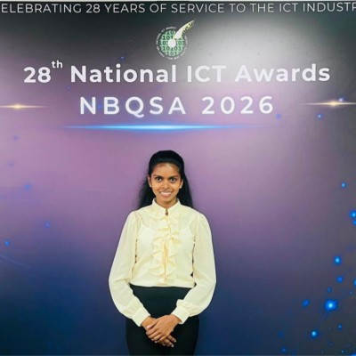

<h1 align="center">Hi there, I'm M.K.D. Githmi Thathsarani 👋</h1>
<h3 align="center">Full-Stack Developer | Cloud & Microservices Enthusiast</h3>

  

  

---

### 👩‍💻 About Me

* 🚀 **Full-Stack Developer** crafting scalable solutions with clean architecture.
* 🌴 Based in **Sri Lanka**.
* 💡 Passionate about **Cloud Computing** & **Microservices**.
* 🏆 Proud participant/winner of **National ICT Awards - NBQSA**.
* 🎯 Currently focusing on building robust applications using **Java, Python, React, and Spring Boot**.
* 📫 How to reach me: **@MKDGThathsarani**

---

### 🛠️ Tech Stack & Tools

  <!-- Frontend -->
  
  
  
  
  
  <!-- Backend -->
  
  
  
  
  <!-- Tools & Cloud -->
  
  
  

---

### 📊 GitHub Stats

  
  

  

---

### 🤝 Connect with Me

  
  

 
  <i>"Building scalable systems with clean architecture."</i>

